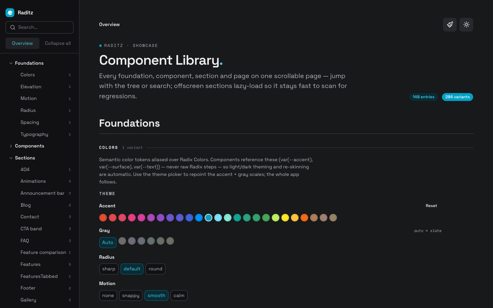

# Raditz

[](https://github.com/tmhnsly/raditz/actions/workflows/ci.yml)

A React and TypeScript design system for building fast prototypes that still look
finished. Accessible components, light and dark themes, and one accent token that
re-skins everything.

**[Live showcase](https://raditz-nine.vercel.app)** · **[In use: Beatz DJ Studio demo](https://beats-dj-studio.vercel.app)**



## At a glance

- **107 components** in 13 categories, **26 page sections** with variants, and 8 full
  example pages (landing, pricing, dashboard, docs, auth and more).
- **Tokens over Radix Colors.** Components only use semantic tokens (`--accent`,
  `--surface`, `--text`), so light/dark mode and re-theming (accent, gray, radius,
  motion) are automatic.
- **Accessibility is a test gate.** Every story is rendered and checked with axe;
  1,500+ tests run in CI alongside the typecheck and both builds.
- **Strict TypeScript** with no `any` or `@ts-ignore`.
- **Packaged and versioned** as `@tmhnsly/raditz` on GitHub Packages, with a
  changelog and a gated release script.

## In use: Beatz DJ Studio


A concept redesign for a real DJ studio in Farnham, Surrey, built entirely from
Raditz sections and components to test the system on a real business's content.
Not commissioned; shown with the owner's permission.

## How it was built

Designed and built by [Tom Hinsley](https://tomhinsley.com) with Claude Code as a
pair. The working method is in the repo:

- `docs/superpowers/specs` and `plans`: design specs and step-by-step implementation
  plans, written before the code.
- `docs/adr`: architecture decision records for the calls worth remembering.
- `CONTEXT.md` and `CLAUDE.md`: the domain language and house rules.
- `catalog/llms.txt`: a generated component catalogue, so an AI agent building a
  product composes existing Raditz parts instead of inventing new ones.
- `skills/`: Claude Code skills to start a new product on Raditz (`raditz-new`) and
  promote a component back into the library (`raditz-promote`).

## Run it locally

```bash
pnpm install
pnpm storybook    # the library (Foundations / Components / Sections / Pages)
```

## Using Raditz in a product

Raditz publishes to **GitHub Packages** as `@tmhnsly/raditz`. Consumers alias it
back to the bare name so every documented import path (`from 'raditz'`,
`raditz/styles.css`, `raditz/catalog/llms.txt`) stays correct.

In the product repo:

```bash
# .npmrc  (committed — CI needs it too)
@tmhnsly:registry=https://npm.pkg.github.com
//npm.pkg.github.com/:_authToken=${NPM_TOKEN}
```

```jsonc
// package.json
"dependencies": {
  "raditz": "npm:@tmhnsly/raditz@^0.3.1"
}
```

`NPM_TOKEN` is a GitHub PAT with `read:packages`. Set it locally (shell profile
or a local `.env`) and add it to CI — on Vercel, as an Environment Variable for
all environments. The package ships prebuilt `dist` + `catalog`, so consumers
install fast and need no build toolchain of their own.

### Releasing

```bash
pnpm release:gate                     # preflight + build + consumer check + tests
npm version <patch|minor|major>
npm publish                           # publishConfig pins it to GitHub Packages
git push && git push --tags
```

`publishConfig.registry` means a stray `npm publish` cannot reach npmjs.com.

### Co-developing against a product

From the product repo, `pnpm rdz:link` swaps the dependency to `link:../raditz`
and `pnpm dev:lib` builds + watches the library alongside the app. Run
`pnpm rdz:unlink` before committing — a `link:` spec in `package.json` breaks
every build that isn't on your machine.

## What's inside

A personal UI library, organized in Storybook into:

- **Foundations** — colors, typography, spacing, radius, elevation, motion (token docs)
- **Components** — 107 real React components across 13 categories
  (actions, data, disclosure, display, feedback, inputs, layout, media, motion,
  navigation, overlay, surfaces, typography), each with a story + autodocs
- **Sections** — 26 composable page sections, each with variants
- **Pages** — full example pages (Landing, Pricing, Showcase, Dashboard, Article,
  Docs, Auth, Contact) composed from sections + components

## Folder-per-thing structure

Every component and section lives in its own folder with all its parts co-located:

```
src/components/actions/Button/
  Button.tsx          # implementation (strict TS, renders rdz-* classes)
  Button.scss         # co-located styles (split from the design system)
  Button.stories.tsx  # Storybook story + autodocs
  Button.test.tsx     # smoke test (renders every story)
  index.ts            # barrel — `import { Button } from '.../actions/Button'`
```

Sections follow the same pattern under `src/sections/<Name>/`. Per-component
`.scss` files are aggregated (in cascade order) by `src/styles/components.ts`,
which the app and Storybook import once — components do **not** import their own
styles.

## Commands

```bash
pnpm storybook    # the library — Foundations / Components / Sections / Pages
pnpm dev          # the explorer showroom (auto-built from the stories)
pnpm test         # vitest — every story renders + zero axe violations
pnpm build        # type-check + production build
pnpm build:pkg    # the distributable package (dist/: JS lib + raditz.css)
pnpm build-storybook
```

## How it's wired

- **Tokens** live in `src/styles/tokens/` and load via `src/styles/styles.css` (Radix scales →
  fonts → tokens → reset). Radix scales are vendored from `@radix-ui/colors` and the fonts
  are self-hosted via `@fontsource*` — no runtime CDN, works offline.
- **Component styles** are co-located per component (`<Name>.scss`) and aggregated in cascade
  order by `src/styles/components.ts`, imported once by the app and Storybook (Sass). The
  package build emits them all as one `dist/raditz.css` (`raditz/styles.css`).
- **Components** are strict TypeScript (`.tsx` with inline-exported prop interfaces — full
  IntelliSense) and render `rdz-*` classes. No `@radix-ui/react-*` — interaction primitives
  are their own, in `src/components/internal/`. Real runtime deps are deliberate and few:
  `@visx/*` (charts), `date-fns` (calendar/date logic), `react-icons` (the Icon set);
  `react`/`react-dom` are peers.
- **Shared hooks/utils** live in `src/components/internal` and are reused across components
  instead of re-implemented: `cx` (class names), `onKeys`/`rovingIndex`/`KEYS`
  (keyboard), `useControllableState`, `useTrigger` (overlay open-state), `useStableId`,
  and the overlay hooks (`useDismiss`, `useFocusTrap`, `useScrollLock`,
  `useOverlayPosition`, `useRovingMenu`). A curated set is re-exported for consumers
  via `src/lib/hooks.ts` (`cx`, `useReducedMotion`, `useInView`, `useRevealState`,
  `useControllableState`, `splitText`).
- **Accessibility** is enforced by `src/a11y.test.tsx`, which renders every component and
  asserts zero axe-core violations (part of `pnpm test`).
- **Theming**: toggling `class="dark"` on `<html>` re-themes everything — the
  `useColorScheme` hook (system-aware: follows the OS until the user overrides) and
  Storybook's **Theme** toolbar toggle both do this.
- **Sections** export one component per variant (`HeroA`, `HeroB`, …) plus an aggregate.
  Content flows in through props (required essentials, optional extras, a `children`
  escape hatch); interactive ones use React state (Navbar dropdown, FAQ accordion,
  Pricing toggle).
- **Pages** wrap section variants in `.rdz-page`, which flattens the preview frame so they
  stack into a seamless page.

## Layout map

```
src/
  components/<category>/<Name>/   tsx · scss · stories · test · index
  components/internal/            shared primitives (overlay, controllable state)
  sections/<Name>/                tsx · css · stories · test · index   (+ sections.css helpers)
  foundations/                    Colors/Typography/Spacing/Radius/Elevation/Motion docs
  pages/<Name>/                   example pages composed from sections
  explorer/                       the public showroom (auto-built from stories)
  lib/                            consumer-facing helpers (theme, hooks, sections shell)
  styles/                         styles.css + tokens/* · components.ts (scss aggregator)
  index.ts                        generated public barrel (pnpm gen:barrel)
catalog/                          generated llms.txt component catalog
.storybook/                       main.ts · preview.tsx · preview-head.html
```
